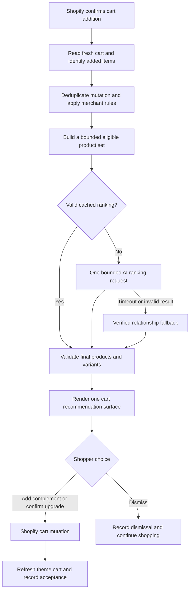

# Returning AOVBoost to an AI upsell and cross-sell app

Prepared November 1, 2026 from the current repository at commit `a776b32`.

This report proposes the change; it does not implement it. The assessment of the current look comes from the React/Polaris screens, widget markup/styles, placement rules and existing design documentation. The authenticated Shopify app and a merchant's live theme were not visually inspected, so theme-specific appearance remains to be verified.

## Recommendation

**AOVBoost can return to its original purpose without rebuilding the app.** Most of the required foundation is still present: cart-add detection, product and variant data, product relationships, recommendation cards, cart mutations, offer tracking and order attribution.

The proposed product promise is simple:

> After a shopper successfully adds an item to the cart, AOVBoost recommends a small set of relevant complementary products or a clearly identified upgrade, and lets the shopper accept the recommendation immediately.

This requires a focused refactor of trigger handling, product ranking and presentation. Changing the greeting or switching chat off would not resolve the current cart-placement restrictions. Reverting the whole repository would also discard useful authentication, cart-safety and attribution improvements.

## 1. What the app currently looks and acts like

The merchant app uses Polaris pages and cards. Its navigation contains **Home**, **Revenue Dashboard** and **Revenue Engine**. The dashboard includes AOV, attributed revenue, widget performance, chat engagement and catalog readiness. Settings expose chat, bundles, cart upsells, progress nudges, exit intent, post-purchase offers, proactive assistance, hesitation detection, brand voice and store FAQs.

The storefront has a broad behavioral engine with several independent surfaces: chat, recommendation strips, bundle cards, cart complements, notices, banners and recovery popups. The current styling already includes product images, prices, variant selectors, Add to cart buttons and loading/error states. These are suitable for a recommendation app and can be retained.

However, the current product has become broader than the cart event the user wants to prioritize. A large trigger catalog and assistant-oriented settings make the central purpose less obvious to merchants.

| Current element | Proposed treatment |
| --- | --- |
| Polaris layout, existing cards, charts and catalog status | Retain the visual foundation. |
| Revenue Engine settings | Rename/reorganize around **Recommendations**. |
| Chat greeting, FAQs and proactive-agent controls | Remove from the default recommendation setup; retain chat as an optional, separately controlled feature initially. |
| Existing cart recommendation cards | Reuse, with clearer complementary-product versus upgrade actions. |
| Product-page recommendation strips and bundles | Optional placements; they must not prevent a confirmed cart-add offer. |
| Live alerts, countdowns, exit intent and progress nudges | Disable in the focused default experience; retain code/settings during the transition. |
| Post-purchase extension | Keep separate and optional; it is not needed to restore pre-checkout cart recommendations. |

Sources: `app/routes/app.tsx:110`, `app/routes/app._index.tsx`, `app/routes/app.settings.tsx:329`, `storefront-sdk/src/widgets/UpsellDrawer.ts`, `docs/WIDGET_PLACEMENT.md`.

## 2. Why the original cart experience is not reliable today

The cart path still exists:

`successful cart request → EventBus → cart_item_added → OfferPoller → /api/offer → decision engine → widget manager`

The following rules explain the gap between that path and an immediate cart recommendation experience. These are source-code findings, not a claim that each has been reproduced on a live store.

| Finding | Current behavior | Required change |
| --- | --- | --- |
| Cart offers wait for the cart page | `placement.ts` rejects `upsell_drawer` outside `/cart` with `upsell_waits_for_cart_page`. It also excludes native cart drawers from ordinary safe anchors. | Add an explicit cart-drawer placement path and a controlled immediate-add presentation. Preserve the safety rules for unrelated widgets. |
| A browsing widget can occupy the recommendation slot | `widgetManager.ts` allows one merchandising block per page. A product-page bundle or recommendation strip can suppress a later cart offer. A mounted inline offer also remains unchanged across new decisions. | Separate cart recommendations from browsing placements, and refresh the cart surface when the cart changes. Preserve selected options while the same decision remains valid. |
| AI ranking is disconnected | `rankOffers()` exists in `app/ai/offerRanker.server.ts`, but has no active caller. Current eligible cart offers use deterministic widget routing, and cart-add copy generation explicitly skips AI. | Keep the cart trigger deterministic; connect a bounded AI product-ranking step to the cart recommendation path. |
| Existing cart contents can be treated as a new addition | `installInitialCartTracking()` fires `cart_item_added` when it finds a nonempty cart on page load. | Distinguish `cart_restored` from a confirmed new mutation. Restore an existing recommendation unobtrusively rather than opening another offer on every page. |
| Dismissal rules differ between server and client | The decision engine makes an exception for required cart-add upsells, while the widget manager applies a generic dismissed-widget rule. | Use one policy based on the offer/cart context and a clear cooldown. A new cart event must not override an explicit recent dismissal indiscriminately. |
| Some sales helpers depend on chat | `toMerchantSalesSettings()` maps `agentEnabled` to `chatEnabled`. The main cart offer path separately uses `upsellEnabled`. | Keep recommendation enablement independent when reusing sales ranking helpers; otherwise disabling chat could disable reused helper logic unexpectedly. |

Relevant references: `storefront-sdk/src/widgets/placement.ts:275`, `storefront-sdk/src/widgets/widgetManager.ts:61`, `app/ai/decisionEngine.server.ts:124,186,256`, `storefront-sdk/src/triggerRouter.ts:515`, `app/sales/settings.ts:8`.

The historical commit `eb715b3` is explicitly titled “Make bundles and cart upsells deterministic.” That explains part of the current direction. Restoring AI relevance should not mean letting an LLM replace a cart offer with chat again: **the app should decide when and where to recommend; AI should rank eligible products within that decision.**

## 3. The intended shopper experience

1. The shopper chooses a product and variant using the store's normal controls.
2. Shopify confirms the cart addition. A button click or custom theme event alone is insufficient proof of success.
3. AOVBoost reads the updated cart and identifies the item(s) just added.
4. The backend filters valid products, ranks a small candidate set and returns at most two or three recommendations.
5. The recommendation appears in the existing cart drawer, or in one controlled AOVBoost surface when no competing cart modal is open. The cart page remains an inline fallback.
6. The shopper selects any required variant and explicitly adds a complement or accepts a named upgrade.
7. The cart total/count and theme sections update, and the shopper continues shopping or checks out.
8. Dismissal, failed requests, or no eligible products leave ordinary shopping usable.

The original add-to-cart request must never wait for an AI result. A slow recommendation should fall back promptly to verified product relationships or show nothing.



### Cross-sell and upsell must mean different actions

The existing `UpsellDrawer` mainly displays **additional complementary products**. That is a cross-sell, despite its internal name. The sales helper `rankUpsells()` also scores complements and add-on affordability; it does not establish that a product is a superior replacement.

| Type | Example, using illustrative products/prices | Action |
| --- | --- | --- |
| Cross-sell | Shopper adds a $20 shampoo; recommend a compatible $12 conditioner. | **Add to cart**. Keep the original item. |
| Upgrade upsell | Shopper adds 250 ml shampoo for $20; offer a verified 500 ml option for $28. | **Upgrade for $8 more** after explicit confirmation of the exact replacement. |

A higher price or shared collection alone does not prove a legitimate upgrade. Start with merchant-approved upgrade relationships or unambiguous larger-pack/premium alternatives. Exclude existing cart products from additive cross-sells, but permit a different eligible variant of the source product when it is a valid upgrade.

A replacement flow requires additional work beyond the current additive cards: identify the current cart line key, preserve quantity and relevant properties, revalidate the cart, and handle partial failure of separate cart mutations. Do not remove the original before the replacement is successfully added. Do not retry a timed-out add blindly; reconcile the actual cart first. For subscriptions, bundles or special line properties, show only offers whose semantics the app can preserve.

## 4. How the storefront should look

Keep the existing theme-aware fonts, button styling, product imagery and variant selectors. Replace the broad assistant-led interaction with a compact recommendation section near the cart items.

Illustrative content for a native cart drawer:

```text
YOUR CART                                      Close
Shampoo — 250 ml                          $20

RECOMMENDED FOR THIS CART
[Image] Conditioner                      $12
        A compatible companion to your shampoo
        [Choose variant]  [Add to cart]

UPGRADE YOUR ITEM
[Image] Shampoo — 500 ml                 $28
        Replace 250 ml with 500 ml
        [Upgrade for $8 more]

Subtotal                                  $20
[Checkout]               Continue shopping
```

These are proposed labels, not live catalog offers. The upgrade and complement need not both appear if only one is appropriate. Display the actual current currency, selected variant price and confirmed replacement difference.

Placement should have a deliberate hierarchy:

1. **Supported native cart drawer:** mount inside a dedicated, safe recommendation slot, without replacing the theme's controls.
2. **No open cart overlay:** optionally reuse the existing floating drawer presentation as one accessible AOVBoost offer, with Escape/close controls, focus management and focus return.
3. **Unsupported or ambiguous theme:** fall back to an inline cart-page section or an explicitly configured merchant placement. Do not inject a second modal over a native drawer.

The current global `EXCLUDED` selector should not simply have all cart-drawer/dialog protections removed. Add a narrowly scoped adapter/slot for cart recommendations. Reattach the section after Shopify/theme section replacement, and verify it remains interactive when the native drawer traps focus. The existing theme app block can support deliberate placement, but its current main-content/cart-page rules need adjustment for a native drawer.

## 5. How the merchant app should change

The merchant interface needs simplification rather than a new visual system.

| Screen | Proposed content |
| --- | --- |
| Home / Overview | Recommendation status; catalog readiness; impressions; accepted recommendations; attributed recommendation revenue; a test-offer action. Retain the existing cards and chart styling. |
| Recommendations | Master enable switch; cross-sell/upgrade preference; product count; excluded/pinned products; placement and frequency controls; preview/test guidance. |
| Analytics | Views → clicks → confirmed cart additions → purchased recommended items. Separate complements from upgrades and AI-ranked from fallback offers. |
| Advanced features | Optional bundles, post-purchase and chat. Keep existing functionality available without making it part of the default cart flow. |

Rename **Revenue Engine** to **Recommendations** and adjust the configuration subtitle. Replace raw product/collection GID text areas with merchant-friendly product selection where practical. Chat engagement should cease being a primary success metric for the default mode.

The first release can reuse `upsellEnabled` as the cart recommendation switch, existing exclusions and existing recommendation-count settings. Make sure the configured count actually reaches rendering, since `UpsellDrawer` currently hard-caps its output at three products. Add schema fields only for controls with new behavior, such as independently selecting cross-sells versus verified replacement upgrades. Preserve existing settings and require a deliberate migration of enabled features for current merchants.

## 6. Recommendation logic and AI responsibilities

Reuse the catalog, affinity and order-history foundation, with a smaller cart-specific decision contract.

The backend should first remove out-of-stock/unavailable variants, excluded products/collections, inappropriate duplicates, incompatible upgrade candidates, recently rejected offers and items whose market pricing is not supported. Explicitly declared shopper requirements may remain hard constraints, but cart recommendations must not require a conversation, a learned intent score, or a hesitation state before becoming eligible.

Build a shortlist from merchant-approved relationships, verified co-purchases, compatible product attributes and existing affinity scores. New stores should have a useful catalog/merchant-rule fallback without pretending to have purchase history. Pinned products must still pass compatibility, availability and exclusion checks.

Use AI once to rank candidate IDs and optionally provide a short grounded reason. Adapt the existing `rankOffers()` rather than placing several model calls in series. It must deduplicate/allowlist returned IDs, respect the requested offer kind, and have a fast deterministic fallback. Use templated card headings by default; a separate copywriting call is unnecessary for every cart addition.

The ranked list must actually control the rendered products. The current endpoint builds candidates, while `getOfferDecision()` also constructs its own catalog-derived shortlist. Consolidate those into one authoritative cart selection path; merely calling the ranker and then rebuilding a different list would leave the same behavior under an AI label.

The AI result must not set prices, fabricate discounts, invent stock, supply arbitrary cart actions, or invent products. Rehydrate the final cards from verified catalog/variant records after ranking. Shopify remains authoritative when the shopper accepts a cart mutation.

Cache rankings by shop, source item/variant, relevant cart contents, market/currency, settings version and catalog version. Cache reusable ranking results, not a different shopper's tracking identity. Revalidate eligibility before rendering; quantity or empty-cart changes must not be hidden by stale session state. The existing `OfferPoller` currently falls back to session cart IDs when the live cart has zero items: a successfully read empty cart should instead be authoritative.

## 7. Concrete implementation map

| Area | Reuse | Refactor / extend |
| --- | --- | --- |
| Cart detection | `storefront-sdk/src/eventBus.ts` | Keep successful fetch/XHR interception; validate custom events, batch adds and native-form navigation. Tag recommendation-originated adds to avoid an endless chain of offers. |
| Trigger routing | `storefront-sdk/src/triggerRouter.ts` | Prioritize confirmed cart additions; distinguish restored carts; normalize a single mutation ID; remove browsing/proactive triggers from the focused default. |
| Recommendation request | `storefront-sdk/src/offerPoller.ts` | Use a fresh, locale-aware cart snapshot; carry source variants and cart version; discard stale responses after navigation or another mutation. |
| Offer endpoint | `app/routes/api.offer.tsx` | Keep authentication, tenant checks, exclusions, rate limiting, caching and catalog validation. Add a cart-specific ranking path before broad widget/proactive handling. |
| Product selection | `app/models/offer.server.ts`, catalog/affinity helpers | Reuse bounded candidate lookup and distinguish additive complements from replacement upgrades. |
| AI ranking | `app/ai/offerRanker.server.ts`, `client.server.ts` | Connect the existing ranker; validate unique IDs and use one latency budget with fallback. |
| Widget decisions | `app/ai/decisionEngine.server.ts` | Keep deterministic cart routing and existing non-cart behavior for optional features; do not let the LLM choose chat for a cart recommendation. |
| Display | `widgets/placement.ts`, `widgetManager.ts`, `UpsellDrawer.ts` | Add a cart-specific slot/adapter and lifecycle; stop browsing widgets suppressing cart offers; implement explicit upgrade actions separately from additive buttons. |
| Cart writes | `storefront-sdk/src/shopifyCart.ts`, `widgets/BaseWidget.ts` | Reuse locale-aware mutations and bundled section updates. Extend carefully for confirmed replacement operations and refreshed drawer mounts. |
| Merchant UI | `app/routes/app.tsx`, `app._index.tsx`, `app.settings.tsx` | Reorganize labels, defaults and settings around recommendations while keeping the existing Polaris design. |
| Outcomes | Existing `Offer`, `RecommendationOutcome`, `ShopperEvent`, order webhooks | Track actual display, accepted cart writes and purchased recommendations. Add a reliable offer-to-outcome link using existing metadata or a justified schema change. |

Shopify's current Ajax Cart API supports variant-based additions, locale-aware URLs and bundled section rendering. The existing shared cart helper already follows that approach. Reuse it for the focused flow rather than adding another competing cart client. An unsuccessful add must not be presented as accepted, and a failed HTML section refresh must not trigger a duplicate successful add. [Shopify Cart API](https://shopify.dev/docs/api/ajax/reference/cart), [locale-aware requests](https://shopify.dev/docs/api/ajax)

The existing `/api/offer` endpoint is sufficient; a new public endpoint or a Shopify app reinstall is not inherently required for this refactor. A changed scope or installed app-proxy problem would be a separate deployment prerequisite. Keep the current app domain, expiring-token support, session validation, tenant boundaries and verified order handling.

## 8. Measurement and hosting impact

Use **attributed recommendation revenue**, acceptance rate and purchased recommended items as primary metrics. Define each denominator explicitly: a generated decision is not an impression, a button click is not a successful cart addition, and a cart addition is not a completed purchase. Record an impression only once the card is actually displayed. Use signed order webhooks to confirm purchases and deduplicate redelivery.

A true upgrade should report its confirmed additional value separately from gross recommended-product revenue. Do not label every legacy record named “upsell” as a replacement: existing additive cards used that name too. Preserve historical rows and normalize reporting only where the underlying action is known. Observed AOV changes do not demonstrate causal lift without a suitable experiment.

The focused flow can reduce Vercel requests by disabling unnecessary live polls/proactive triggers and merging or reducing heartbeat traffic. Its main requests become a bounded offer lookup per eligible cart mutation and batched analytics. That saving is a proposed outcome, not a benchmark. Product-webhook full-cache rebuilds, order-affinity fan-out and whole-dataset analytics identified in [the Hobby review](vercel-hobby-audit.md) still require their own fixes. Hosting plan eligibility and resource allowances remain separate concerns.

## 9. Rollout and acceptance

This is a moderate refactor, with theme compatibility and cart correctness likely to take more effort than the visual changes. Recommended sequence:

1. **Define the contract and focused defaults.** Confirm the offer types and placements; separate recommendation enablement from chat; retain existing settings/data. Establish an explicit pilot opt-in without silently changing every merchant's storefront.
2. **Restore the cart-triggered cross-sell journey.** Fix placement, mutation identity, stale-response handling, repeated initial-cart offers and dismissal consistency. Demonstrate a successful add from a product page and quick-add collection before introducing more behavior.
3. **Connect AI ranking.** Use eligible shortlists, caching, one bounded model call, catalog revalidation and deterministic fallback. Test invalid/duplicate model IDs and provider outages.
4. **Add verified upgrade behavior.** Introduce approved upgrade relationships and explicit replacement confirmation; reconcile partial failures. Ship only supported line types.
5. **Simplify the merchant screens and analytics.** Reuse the existing design, change labels/default emphasis, and verify impression/acceptance/order correlation.
6. **Pilot, measure and expand.** Verify the actual Vercel backend, Shopify app proxy, app embed and regenerated SDK asset. Deploy backend and Shopify extensions/configuration through their separate workflows. Roll back routing/defaults if needed without dropping data or reversing token migration.

Release checks should include:

- Product-page, collection quick-add, Ajax/XHR, full-page form, multiple-item and mobile cart flows on supported themes.
- Exactly one recommendation decision for a confirmed mutation; failed adds, restored carts and the app's own accepted recommendations do not cause repeated unsolicited offers.
- Existing product-page bundles or recommendation strips do not suppress the cart surface.
- Fresh cart contents win, including empty carts, changed quantities, concurrent tabs and out-of-order responses.
- Unavailable/excluded products, missing variants, unsupported selling plans, invalid market prices and unrelated premium products are withheld.
- Variant choice, prices, totals and native drawer controls remain correct after acceptance; failed replacement steps are reconciled without losing the original item or blindly duplicating the replacement.
- Dismissal/cooldown, keyboard focus, Escape, screen-reader labels and safe placement behave consistently.
- Impression, click, confirmed add and purchase metrics agree, including duplicate events/webhooks and legacy records.
- AI timeout, app-proxy failure, Redis/database issues and theme section errors leave the merchant's normal cart working.
- Consent and existing privacy choices remain respected; browser-exposed configuration contains no server credentials.

**The restoration should make cart recommendations the primary product and keep the current platform foundation. The main changes are a dedicated cart surface, a connected AI ranker, a simpler merchant setup and explicit semantics for complements versus upgrades—not a wholesale rollback of AOVBoost.**
